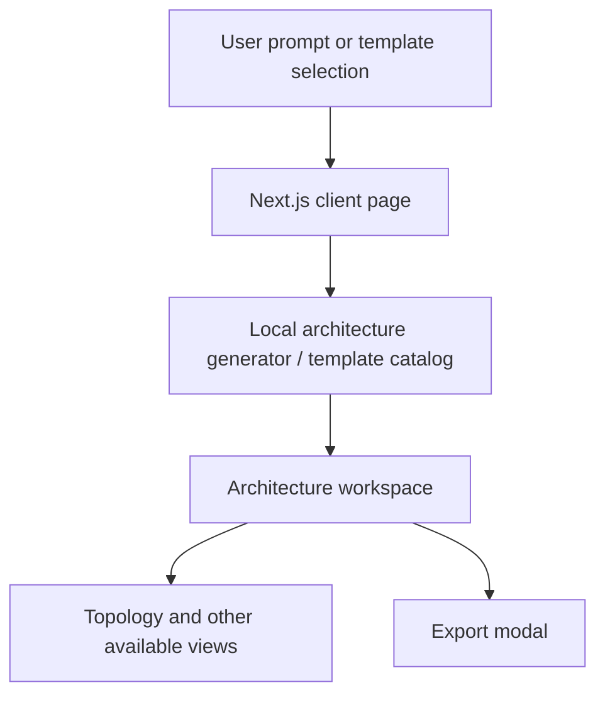

# System Architect AI 🏗️

**System Architect AI** is a web-based prototype for exploring software-system architectures from natural-language prompts. It combines a Next.js interface, predefined architecture templates, a client-side generation module, an interactive workspace, and an export modal.

> **Current implementation status:** The home page currently simulates a generation/loading delay and then calls a local `generateArchitectureFromPrompt` function. This README does not claim that a live LLM API is connected. Treat the generated diagrams and template content as design aids that require engineering review—not automatically validated or production-ready architectures.

## What It Does

- **Prompt-based exploration:** Enter a system description to create an architecture view through the local generator.
- **Prebuilt templates:** Open example systems for a smart hospital, drone delivery, and autonomous warehouse.
- **Interactive workspace:** Inspect the generated architecture using the available workspace views.
- **Export workflow:** Open the export modal for the selected architecture.
- **Dark UI:** Built with a dark interface, animated components, and iconography.

Available details and export formats depend on the implementation in the current branch.

## Screens / Workflow

1. Start on the home page and enter a system prompt, or choose a predefined template.
2. The UI displays a loading state while the client-side handler runs.
3. Review the resulting architecture in the workspace.
4. Use the navigation controls to switch views and open the export workflow when an architecture is loaded.

## Technology Stack

- **Framework:** Next.js App Router
- **UI:** React and TypeScript
- **Styling:** Tailwind CSS
- **Animation:** Framer Motion
- **Icons:** Lucide React
- **Utilities:** `clsx`, `tailwind-merge`

The current `package.json` identifies Next.js 16, React 19, and Tailwind CSS 4.

## High-Level Architecture



This diagram reflects the checked-in client-side flow. It is not a claim of a deployed backend or external AI inference service.

## Project Structure

```text
system-architect-ai/
├── src/
│   ├── app/             # Next.js routes, page, layout, global styles
│   ├── components/      # UI and workspace components
│   ├── lib/             # Generator and predefined templates
│   └── types/           # TypeScript architecture types
├── public/              # Static assets
├── package.json
└── README.md
```

## Prerequisites

- Node.js version compatible with the installed Next.js version
- npm (or another compatible package manager)
- Git

## Run Locally

```bash
git clone https://github.com/Rohith00755/system-architect-ai.git
cd system-architect-ai
npm install
npm run dev
```

Open [http://localhost:3000](http://localhost:3000) in your browser.

## Available Scripts

| Command | Purpose |
|---|---|
| `npm run dev` | Start the development server |
| `npm run build` | Build the application for production |
| `npm run start` | Start the production server after a successful build |
| `npm run lint` | Run ESLint |

## Important Limitations

- The generation handler currently uses a simulated delay before calling a local generator function.
- The presence of architecture labels or descriptions such as OpenAPI, PyTorch, PostgreSQL, or cloud deployment does not by itself mean those systems are implemented, generated, or validated.
- Architecture output should be reviewed for security, reliability, cost, scalability, and deployment constraints before implementation.
- The README does not claim measured generation accuracy, production readiness, or integration with an external LLM.

## Suggested Next Steps

1. Document the exact behavior and supported prompt patterns in the local generator.
2. Add screenshots or a short GIF of prompt-to-workspace interaction.
3. Document which export formats are actually supported by the export modal.
4. Add unit tests for template selection, generated architecture structure, and export behavior.
5. If connecting an LLM, add a documented server-side API route, input validation, error handling, and secure environment-variable configuration.
6. Add a sample architecture and explain how to validate generated diagrams before using them in real systems.

## Author

**Rohith S** · [GitHub](https://github.com/Rohith00755) · [LinkedIn](https://www.linkedin.com/in/rohith-sathish-971052327)
